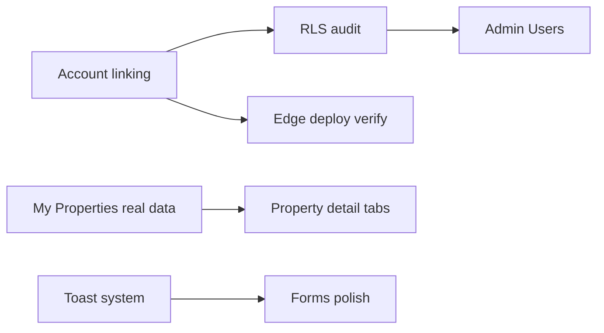

# NexEstate — Upgrade Roadmap

**Date:** 2026-10-10  
**Prerequisite:** Supabase project active; Google OAuth working (user-verified).  
**Out of scope for Phase 1:** Full visual redesign.

---

## PHASE 1 — CRITICAL FIXES (P0 + account alignment)

**Status (2026-10-10):** **READY FOR PHASE 2.** Authenticated QA done with one controlled `admin`. Google login PASS. Dashboard / My Properties / support form / session / logout / empty states / mobile PASS. Admin Users / Shares / Import / Support + `admin-import-deals` + admin RLS PASS. See `docs/NEXESTATE_PHASE_1_COMPLETION.md`.

**Goal:** Production truth matches UI; ops can manage env/DB safely.

| # | Item | Effort | Owner |
|---|------|--------|-------|
| 1.1 | Link Supabase MCP + CLI to `ynpdtbgmbunntckqmcaf`; run advisors (security + performance) | S | Ops |
| 1.2 | Link Vercel to Nexestate team; document `VITE_*` and Edge secrets (names only) | S | Ops |
| 1.3 | Replace **My Properties** demo with real `properties` query | M | Dev |
| 1.4 | Wire **Admin Shares** to `property_shares` | M | Dev |
| 1.5 | **Admin Import** — real CSV path (reuse `scripts/import-csv` or Edge) | L | Dev |
| 1.6 | **Admin Users** — profiles CRUD + approval workflow | L | Dev |
| 1.7 | **Admin Support** — schema + UI or remove nav until ready | L | Dev |
| 1.8 | Fix `paymentCount` in sidebar stats; verify `lease_payments` data | S–M | Dev |
| 1.9 | RLS regression matrix: broker / partner / buyer / admin | M | Dev + QA |
| 1.10 | Verify all Edge Functions deployed (signing, email, payments) | M | Ops |

**Exit criteria:** No P0 demo pages in admin/broker primary nav; RLS smoke tests pass; env documented.

---

## PHASE 2 — PROFESSIONAL WORKSPACE

See `docs/PHASE_2_IMPLEMENTATION_PLAN.md`. **2A in progress:** navy/slate foundation, shared interaction primitives, attention-first dashboard.

| # | Item | Effort |
|---|------|--------|
| 2.1 | Typography scale: base `text-base` in shell; stat labels `text-sm` minimum | M |
| 2.2 | Global toast + inline form errors | M |
| 2.3 | Loading system: skeletons on broker home, property detail, tables | M |
| 2.4 | Empty states audit — copy + CTA on every list page | M |
| 2.5 | Design tokens doc in `theme.css` (spacing, radius, elevation) | S |
| 2.6 | Buyer nav: add חיפוש + מועדפים | S |
| 2.7 | SEO: meta description, OG, legal pages canonical | M |

**Exit criteria:** Dashboard readability sign-off; consistent feedback on save/delete.

---

## PHASE 3 — CORE FUNCTIONALITY IMPROVEMENTS

**Goal:** Deep workflows brokers use daily.

| # | Item | Effort |
|---|------|--------|
| 3.1 | Property detail **inline tabs** (units, tenants, leases, payments) | L |
| 3.2 | Payments: generate schedule from leases; proof upload UX | L |
| 3.3 | Buyer notifications → real `notifications` table | S |
| 3.4 | Admin home charts from live aggregates | M |
| 3.5 | Leads/clients: filters + URL state | M |
| 3.6 | Signing flow E2E test + PDF storage verification | M |
| 3.7 | Share property modal: permission levels + email notify | M |

**Exit criteria:** Broker can manage one building end-to-end without leaving property context.

---

## PHASE 4 — ADVANCED FEATURES

| # | Item | Effort |
|---|------|--------|
| 4.1 | Auctions: live bids + notifications | XL |
| 4.2 | Reports: scheduled exports, email delivery | L |
| 4.3 | Multi-property portfolio dashboard for owners | L |
| 4.4 | Buyer search: relevance, saved searches | L |
| 4.5 | Invoice/payment provider hardening (webhook idempotency) | L |

---

## PHASE 5 — POLISH / PERFORMANCE / ANALYTICS

| # | Item | Effort |
|---|------|--------|
| 5.1 | Route-based code splitting (target <400KB initial) | M |
| 5.2 | Vitest for services; Playwright smoke (login, broker home) | L |
| 5.3 | Sentry + Vercel log drains | M |
| 5.4 | Product analytics event model (login, lead, share, sign) | M |
| 5.5 | Responsive `DataView` for all tables | M |
| 5.6 | A11y pass: focus rings, modal trap, contrast | M |
| 5.7 | PWA: offline shell, update prompt | S |

---

## Recommended next step

**Start Phase 1.1–1.3** in parallel: ops reconnects Supabase/Vercel while dev replaces My Properties and Admin Shares demo data. These are the highest user-visible gaps with manageable scope.

---

## Dependency graph (simplified)

